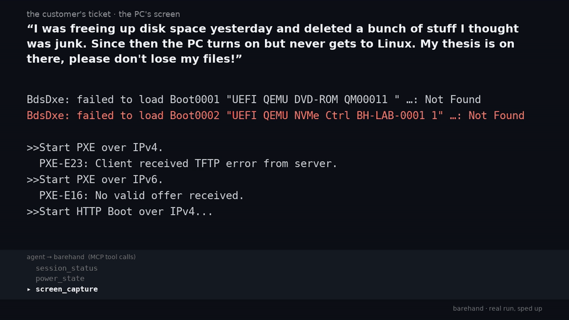
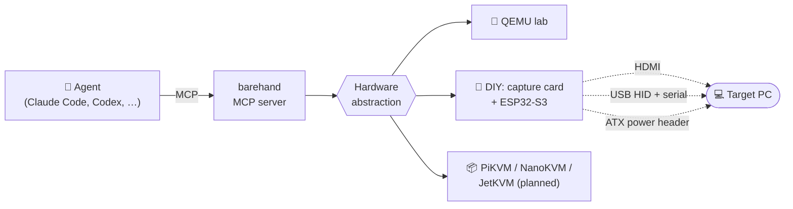

<div align="center">

# 🖐️ barehand

**An AI PC technician that works *below* the operating system.**

Give an agent eyes on another computer's screen and hands on its keyboard, power button and boot media,<br>
then let it fix boot loaders, tweak the BIOS, partition disks and install Windows or Linux like a human tech would.

[](#roadmap)
[](https://modelcontextprotocol.io)
[](skills/barehand/SKILL.md)
[](#hardware)
[](package.json)
[](LICENSE)

<br>



<sub>A real run, sped up: Debian stuck in emergency mode → network boot of a rescue system → <code>/etc/fstab</code>
fixed over the serial shell → power-cycled with no help, boots on its own.
<a href="docs/media/clip.mp4">MP4</a> · <a href="docs/media/demo.mp4">longer version with the agent's tool calls</a></sub>

</div>

---

## Why

Remote-desktop tools stop working exactly when you need them most: when the machine **won't boot**.
GRUB is gone, the EFI entry vanished, Windows is stuck in an automatic repair loop, the boot order is wrong,
or the disk has to be wiped and reinstalled. Those problems live in the BIOS, the boot menu and the
installer, where no software agent can reach.

**barehand** reaches them with a few dollars of hardware sitting *outside* the target PC:

| The target PC sees… | …which is really |
|---|---|
| 🖥️ a monitor | an HDMI capture card the agent looks through |
| ⌨️ a USB keyboard & mouse | a microcontroller the agent types through |
| 🔌 a serial port | a text console into the rescue system, with no network needed |
| 💿 a network boot server | an ISO the agent downloaded, served over PXE/iPXE from the controller |
| 🔘 someone pressing the power button | an optocoupler on the front-panel header |

The agent never needs anything installed on the broken machine.

## What it can do

<table>
<tr>
<td width="50%" valign="top">

### 🩺 Diagnose
- Won't power on? Reads POST codes, debug LEDs and beep codes and walks you through a hardware triage tree
- Stuck on POST, black screen, boot loop, `grub rescue>`
- Reads SMART, `dmesg` and disk layouts from a rescue shell

### 🔧 Repair
- Reinstall / repair **GRUB** and **systemd-boot**
- Rebuild **EFI** entries and Windows BCD (`bcdboot`)
- Fix the boot order (`efibootmgr` or the BIOS setup)
- Recover from Windows automatic-repair loops

</td>
<td width="50%" valign="top">

### 💿 Install
- Download ISOs, **verify checksums**, and **boot them over the network** (no USB stick)
- Unattended **Linux** installs (autoinstall, preseed, kickstart)
- Unattended **Windows** installs (`autounattend.xml`)
- Partitioning plans that are reviewed before anything is written

### ⚙️ BIOS / UEFI
- Enter setup reliably by hammering the right key during the POST window
- Toggle Secure Boot, virtualization, CSM, SATA mode
- Change the boot order and boot once from a device

</td>
</tr>
<tr>
<td colspan="2" valign="top">

### 📚 Knows the hardware it's working on
- **Identifies the machine**: board vendor, model and BIOS version from the POST screen, the BIOS setup or `dmidecode` in the rescue shell
- **Fetches the real documentation**: motherboard/laptop manuals, front-panel header pinouts, Q-LED / POST-code / beep-code tables, BIOS setup keys
- **Reads only what matters**: manuals are cached, converted to text and searched page by page, so a 200-page PDF costs a few paragraphs of context, with page citations

</td>
</tr>
</table>

## How it works



It is built on one design rule: **eyes and hands only to bootstrap, a shell for real work.**

1. **Pixels + keystrokes** where nothing else exists: POST, BIOS setup, boot menus, the first installer screens.
   Time-critical work such as "spam F2 until the screen changes" runs in the server, never in the model's loop.
2. **Boot a rescue Linux** that opens a shell over the USB serial link.
3. **Everything else is text:** `shell_exec` with exit codes, deterministic and verifiable.

Two layers ship together, the same way as their sibling projects:

- **MCP server** for primitive, hardware-agnostic tools: `screen_capture`, `screen_wait`, `key_combo`, `key_spam_until_change`, `type_text`, `power_press`, `media_attach`, `shell_exec`, `iso_download`, `hw_identify`, `manual_fetch`, `manual_search`, `netboot_start`, …
- **Skill** for the technician's playbooks: how to repair GRUB, how to find a BIOS setup key, how to plan a partition layout, when to stop and ask the human.

## Hardware

Start with no hardware at all, and buy the cheap kit when you need a real machine.

| Tier | What | Approx. cost | Gets you |
|---|---|---|---|
| **0 · Lab** | QEMU + OVMF on your own machine | free | Every tool and playbook, against VMs you can break on purpose |
| **1 · DIY** ⭐ | USB HDMI capture card (MS2109) + **ESP32-S3-DevKitC-1** + 2× PC817 optocouplers | **~US$20** | Screen, keyboard/mouse, serial console, power button & LED on a real PC |
| **2 · Appliance** | PiKVM, NanoKVM or JetKVM | US$40 – 300 | Adds built-in virtual media, a standalone box and remote access *(backend planned)* |

**Why the ESP32-S3?** The DevKitC-1 has **two USB-C ports**. The native one plugs into the target and
shows up as a keyboard, mouse *and* serial port (TinyUSB composite device). The UART one plugs into your
controller PC. One board, no extra adapters. (A classic Arduino Uno can't do this: it has no native USB.)

**Boot media needs no hardware:** barehand has a built-in network boot server (proxyDHCP + TFTP + HTTP + iPXE
menu) that coexists with your router's DHCP. Wire the target to the same network and it boots SystemRescue,
Ubuntu, Debian, Fedora, Arch or WinPE straight from the ISOs on the controller. Details: [`docs/netboot.md`](docs/netboot.md).
No Ethernet port? A Ventoy stick works too.

More detail, wiring and a shopping list: [`docs/hardware.md`](docs/hardware.md).

## Quickstart (lab, no hardware)

```bash
git clone https://github.com/silvaan/barehand && cd barehand
npm install && npm run build

# start a disposable UEFI VM to practise on (see lab/README.md)
lab/run-target.sh --iso ~/Downloads/systemrescue.iso --vnc :1

npx barehand doctor                                         # connects, captures a frame
claude mcp add barehand -- node "$PWD/dist/cli.js" serve   # register with Claude Code
cp -r skills/barehand ~/.claude/skills/                     # install the skill
```

For real hardware: flash [`firmware/esp32s3-hid`](firmware/esp32s3-hid), wire it per
[`docs/hardware.md`](docs/hardware.md), then set `BAREHAND_BACKEND=diy`.

<details>
<summary><b>Repository layout</b></summary>

```
src/
  hal/          hardware abstraction: types, QEMU (QMP) backend, DIY backend, ffmpeg capture,
                firmware protocol, HID keymaps (US, ABNT2)
  tools/        MCP tools: screen, input, power & media, console & shell, knowledge (manuals, ISOs)
  safety/       destructive-command guard + pre-change snapshots
  console.ts    serial console with marker-based shell_exec
  screen.ts     server-side screen watching (wait for change/stable, POST key spamming)
  manuals.ts    manual library: download, PDF→pages, search
  netboot/      proxyDHCP, TFTP, HTTP, ISO 9660 reader, per-distro boot recipes, iPXE menu
firmware/esp32s3-hid/   ESP-IDF + TinyUSB: boot keyboard, mice, CDC console, ATX power
skills/barehand/        the technician skill and its playbooks
lab/                    QEMU target VM + (planned) broken-on-purpose scenarios
docs/                   hardware guide, network boot, firmware protocol
```
</details>

## Lab results

Four broken-on-purpose "customer PCs" ([`lab/scenarios`](lab/scenarios/README.md)). Each time, a fresh Claude agent got
only the customer's ticket, the skill and barehand's tools. Nobody told it what was broken. A grader then power-cycled
the machine with no help and passed it only if Debian came up on its own with the customer's files intact.

| Scenario | The customer said | What the agent did | Result | Time | Tool calls | Screenshots |
|---|---|---|---|---|---|---|
| `esp-wiped` | "deleted a bunch of junk, now it never gets to Linux" | netboot rescue → chroot → `grub-install --force-extra-removable` | ✅ PASS | 10.6 min | 43 | 6 |
| `fstab-typo` | "followed a tutorial to auto-mount my backup drive" | netboot rescue → `nofail` on the bad fstab line (with a backup) | ✅ PASS | 9.0 min | 40 | 7 |
| `kernel-deleted` | "ran a /boot cleanup script from a forum" | netboot rescue → chroot → `apt-get install --reinstall linux-image-…` | ✅ PASS | 10.8 min | 41 | 7 |
| `grub-cfg-missing` | "black screen with some kind of prompt" | from `grub>` on the serial line: boot with `init=/bin/bash`, `update-grub` | ✅ PASS | 6.8 min | 50 | 3 |

Emulated without KVM, so every boot is slow; on real hardware these take a fraction of the time. Screenshots stayed
in single digits: pixels to get in, the serial shell for the actual work. The agents' notes on what got in their way
are feeding the next round of fixes ([`TODO.md`](TODO.md)).

## Safety first

An agent that can format disks needs guardrails that don't depend on it behaving perfectly:

- 🛑 **Destructive commands are a separate tool.** `mkfs`, `wipefs`, `dd of=`, `sgdisk --zap`, `diskpart clean`, … are refused by `shell_exec` and must go through `shell_exec_destructive`, which carries a written plan, so your MCP client asks you every time.
- 🔎 **Disks are identified by model + serial + size**, never just by `/dev/sdX`.
- 💾 **The layout is snapshotted before changes**: `sfdisk -d`, `efibootmgr -v` and the ESP contents.
- 🧱 **No autonomous firmware flashing. Ever.**
- ✅ **Every downloaded ISO is checksum-verified** before it is booted.

## Roadmap

- [x] Project skeleton, hardware abstraction layer
- [x] MCP server: 29 tools (screen, keyboard, mouse, power, media, console/shell, manuals, ISOs, netboot)
- [x] Built-in network boot: proxyDHCP + TFTP + HTTP, ISO 9660 reader, recipes for 6 distro families + WinPE
- [x] Destructive-command guard, disk identity check, pre-change snapshots
- [x] QEMU lab backend + target VM script
- [x] Validated end to end in the lab: reset → network boot of SystemRescue 13.02 → root shell over serial → `hw_identify` → guarded partitioning, ~2 min without KVM
- [x] Broken-on-purpose lab scenarios as evals: 4/4 fixed by blind agents
- [x] Skill with first playbooks (BIOS, boot repair, install, no-power triage, manuals)
- [ ] ESP32-S3 firmware validated on hardware (written, not yet flashed) + DIY backend tested
- [ ] More scenarios: BIOS boot order, Windows BCD/WinRE, BitLocker, dual boot
- [ ] Rescue image with an auto-login serial shell
- [ ] Network-boot validation on real PXE ROMs (Intel, Realtek, Broadcom)
- [ ] Full Windows install over the network (SMB share for install.wim)
- [ ] Bundled POST/beep code tables
- [ ] `npx barehand setup --client …` for one-command registration
- [ ] PiKVM / NanoKVM / JetKVM backends

## Status

🚧 **Early development.** The full loop works in the QEMU lab; real hardware (ESP32-S3 firmware, PXE ROMs) is
next. Nothing here is ready to point at a machine whose data you care about yet. Watch the repo to follow along.

## License

[MIT](LICENSE). Use it, fork it, build on it. It comes with no warranty: an agent with a power button can still make
mistakes, so start in the lab and keep the guardrails on.

<div align="center">
<sub>Part of a family of agent toolkits that bring AI to places it couldn't reach before.</sub>
</div>
